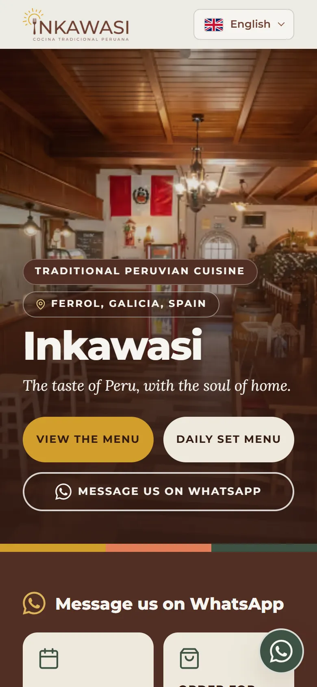
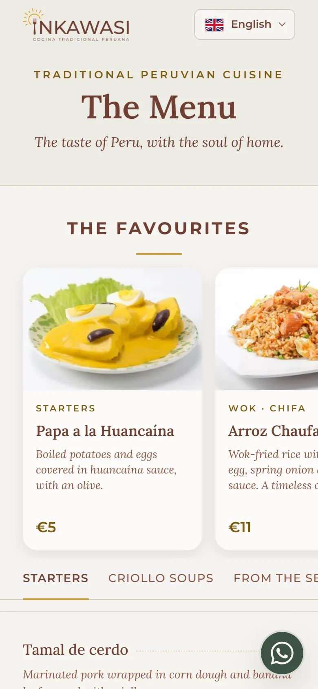
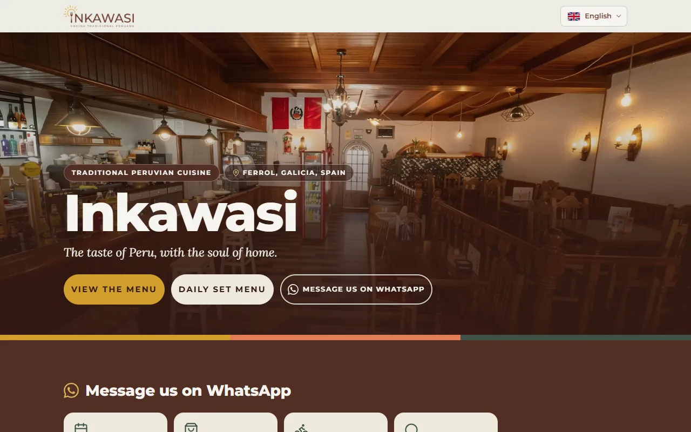

# Inkawasi · Carta web

[](https://github.com/babylonace/inkawasi-web/actions/workflows/ci.yml)
[](LICENSE)

[English](README.md) · **Español**

**Una web rápida y accesible en 10 idiomas para un negocio pequeño, hecha con páginas estáticas.**
Esta es la carta de Inkawasi, un restaurante peruano en Ferrol. Los clientes escanean un QR en la mesa,
así que tiene que cargar rápido en el móvil y hablar su idioma, árabe de derecha a izquierda incluido.

**En vivo:** [inkawasi.es](https://inkawasi.es) · [carta en español](https://inkawasi.es/carta/)

| Inicio, móvil                                                                                                                                                 | Carta, móvil                                                                                                                                        | Inicio, escritorio                                                                               |
| ------------------------------------------------------------------------------------------------------------------------------------------------------------- | --------------------------------------------------------------------------------------------------------------------------------------------------- | ------------------------------------------------------------------------------------------------ |
|  |  |  |

## Qué demuestra

La primera versión salió de una herramienta de diseño: funcionaba, pero era lenta, difícil de leer para
los buscadores y llena de texto fijo. Rehacerla resolvió problemas que tienen casi todas las webs de
negocios pequeños, sean restaurantes o no:

| Problema                          | Cómo se resuelve aquí                                                                                                                                             |
| --------------------------------- | ----------------------------------------------------------------------------------------------------------------------------------------------------------------- |
| Lenta en el móvil                 | Páginas generadas de antemano, 2,2 KB de JavaScript y ninguna petición a otras webs. Rendimiento en Lighthouse de 44 a **95**                                     |
| Muchos idiomas que no se desfasen | Un archivo por idioma, tipado contra el español: una traducción que falta **detiene el build** en vez de dejar un hueco en la web                                 |
| Idiomas de derecha a izquierda    | Árabe de verdad: `dir="rtl"`, propiedades lógicas de CSS y precios aislados para que los números no se den la vuelta                                              |
| Accesibilidad                     | Contraste, regiones, uso con teclado y revisión con axe-core en cada tipo de página. Accesibilidad de 86 a **100**                                                |
| Que la encuentren los buscadores  | Una URL real por idioma con `hreflang`, sitemap y datos estructurados. SEO de 82 a **100**                                                                        |
| Datos erróneos ante el cliente    | Precios en céntimos y los 14 alérgenos oficiales como tipo, comprobados por tests. La auditoría encontró además "cacahuete" traducido como "almendras" en gallego |
| Datos privados que exige la ley   | Fuera de Git; solo los inyecta el build de producción, y un test falla si se filtran                                                                              |

Lighthouse en móvil (throttling simulado, mediana de 3 ejecuciones), primera versión frente a la actual:

| Métrica                  | Antes  | Ahora      |
| ------------------------ | ------ | ---------- |
| Rendimiento              | 44     | **95**     |
| Accesibilidad            | 86     | **100**    |
| Buenas prácticas         | 96     | **100**    |
| SEO                      | 82     | **100**    |
| Largest Contentful Paint | 6,7 s  | **2,6 s**  |
| Saltos de diseño (CLS)   | 0,73   | **0,01**   |
| Peso transferido         | 847 KB | **297 KB** |
| Peticiones               | 36     | **14**     |

## Inicio rápido

Necesitas Node 20 o superior.

```bash
git clone https://github.com/babylonace/inkawasi-web.git
cd inkawasi-web
npm ci
npm run dev        # todas las páginas e idiomas en http://localhost:4321
npm test           # 481 tests unitarios
npm run build      # la web estática en dist/
```

Funciona sin ningún archivo privado: las páginas legales usan los textos de ejemplo de `private/negocio.privado.example.json`.

## Cómo funciona

- **Datos y textos van separados.** Platos, precios y alérgenos están en archivos TypeScript tipados; cada
  frase visible está en un JSON por idioma.
- **Las páginas salen de funciones pequeñas y testeadas** que reciben datos y devuelven HTML escapado. Astro
  solo hace las rutas, empaqueta y optimiza fuentes e imágenes; no envía ningún framework al navegador.
- **JavaScript es opcional.** El contenido y el selector de idioma son HTML y enlaces normales; el script de
  2,2 KB añade las pestañas y recuerda el idioma elegido.

El recorrido completo, las decisiones y lo que corrigió la auditoría están en
**[docs/how-it-works.md](docs/how-it-works.md)**; el despliegue, los secretos y las redirecciones, en
**[docs/deployment.md](docs/deployment.md)** (los dos en inglés).

## Úsala para tu propio negocio

Haz un fork y cambia, en este orden:

1. **Marca.** Sustituye `design-system/tokens.json` (colores, espacios, tipografía) y los logos de
   `assets-src/brand/` y `public/assets/`; luego `npm run build:favicon` y `npm run build:og`.
2. **Contenido.** Platos, secciones, precios (en céntimos: `1450` es 14,50) y alérgenos en `src/data/menu.ts`;
   teléfono, dirección y enlaces en `src/render/contact.ts`; mensajes de WhatsApp en `src/data/whatsapp.ts`;
   fotos en `src/assets/fotos/` (hasta 2400 px, el build genera las versiones pequeñas).
3. **Textos e idiomas.** Cada frase está en `src/i18n/locales/<idioma>.json`. Para añadir un idioma: su código en
   `LangCode` (`src/data/types.ts`), una entrada en `src/data/langs.ts` (`rtl: true` si se escribe de derecha a
   izquierda), su archivo JSON y su import en `src/i18n/index.ts`. TypeScript te dirá qué claves le faltan.
   Para quitar uno, lo contrario.
4. **Datos legales.** Copia `private/negocio.privado.example.json` a `private/negocio.privado.json` y rellénalo.
   Nunca se sube a Git.
5. **Publicar.** `dist/` son archivos normales y vale cualquier hosting estático. Para desplegar desde GitHub
   Actions a Cloudflare Pages como este repo, sigue [docs/deployment.md](docs/deployment.md).

Ejecuta `npm test` después de cada paso: un plato sin precio o sin traducción, o un alérgeno fuera de los 14
oficiales, falla con un mensaje que dice dónde.

¿No es un restaurante? Quédate con los pasos 1, 3 y 5 y sustituye `src/data/` y `src/render/` por tu contenido:
los idiomas, las funciones testeadas, las fuentes, las imágenes y el CI funcionan igual.

## Tests y CI

- **481 tests unitarios** (Vitest): funciones de render, formatos por idioma, alérgenos, rutas, sitemap,
  escapado, las reglas del sistema de diseño y un test contra filtraciones de datos privados.
- **112 tests end-to-end y de accesibilidad** (Playwright + axe-core): cada tipo de página, varios idiomas,
  uso con teclado, diseño de derecha a izquierda y WCAG A/AA.
- **Lighthouse CI:** el build falla si el rendimiento en móvil baja de 90, o accesibilidad, buenas prácticas
  o SEO bajan de 95.

GitHub Actions lo ejecuta todo, más formato, lint y tipos, en cada push.

## Stack

Astro · TypeScript estricto · CSS con cascade layers y design tokens · Vitest · Playwright + axe-core ·
Lighthouse CI · ESLint · Prettier · GitHub Actions · Cloudflare Pages.

## Licencia

El código tiene [licencia MIT](LICENSE). El nombre, el logotipo, las fotografías y los textos de la carta de
Inkawasi pertenecen al restaurante y no están cubiertos por ella: ver [NOTICE](NOTICE).

Hecho por [babylonace](https://github.com/babylonace). AI-assisted.
