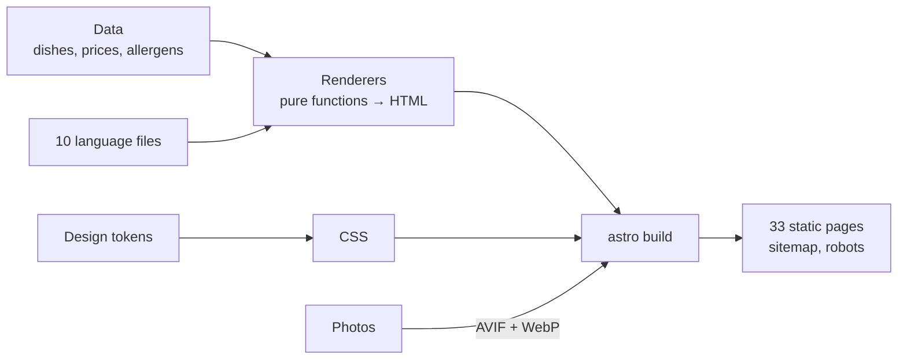

# Inkawasi · Digital menu

[](https://github.com/babylonace/inkawasi-web/actions/workflows/ci.yml)
[](LICENSE)

**English** · [Español](README.es.md)

**A fast, accessible website in 10 languages for a small business, built as plain static pages.**
This one is the menu of Inkawasi, a Peruvian restaurant in Ferrol, Spain. Guests scan a QR code at
the table, so it has to load fast on a phone and speak their language, including right-to-left Arabic.

**Live:** [inkawasi.es](https://inkawasi.es) · [English menu](https://inkawasi.es/en/carta/)

| Home, phone                                                                                                                                                                     | Menu, phone                                                                                                                                         | Home, desktop                                                                             |
| ------------------------------------------------------------------------------------------------------------------------------------------------------------------------------- | --------------------------------------------------------------------------------------------------------------------------------------------------- | ----------------------------------------------------------------------------------------- |
|  |  |  |

## What it shows

The first version was generated with a design tool: it worked, but it was slow, hard to read for
search engines and full of hard-coded text. Rebuilding it solved problems that most small-business
sites have, menu or not:

| Problem                       | How it is solved here                                                                                                                            |
| ----------------------------- | ------------------------------------------------------------------------------------------------------------------------------------------------ |
| Slow on a phone               | Pages are built in advance, ship 2.2 KB of JavaScript and make no requests to other sites. Lighthouse performance 44 → **95**                    |
| Many languages, kept in step  | One file per language, typed against Spanish: a missing translation **stops the build** instead of leaving a blank on the page                   |
| Right-to-left languages       | Real Arabic layout: `dir="rtl"`, CSS logical properties, prices isolated so numbers do not flip                                                  |
| Accessibility                 | Contrast, landmarks, keyboard use and axe-core checks on every page type. Lighthouse accessibility 86 → **100**                                  |
| Found by search engines       | One real URL per language with `hreflang`, a sitemap and structured data. SEO 82 → **100**                                                       |
| Wrong data reaching customers | Prices in cents and the 14 official allergens as a type, checked by tests. The audit also caught "peanuts" translated as "almonds" in Galician   |
| Private data required by law  | Kept out of Git and injected only by the production build, with a test that fails if it leaks                                                    |
| Social feed without embeds    | The latest six Instagram posts, fetched once a day by a scheduled build and served from the site itself: no Meta script, no cookies, never empty |
| Blocked during football       | Spanish ISPs block Cloudflare IPs during LaLiga matches; a Netlify gateway keeps the site up and a small Worker fails back if the gateway breaks |

Lighthouse on mobile (simulated throttling, median of 3 runs), first version vs. now:

| Metric                   | Before | Now        |
| ------------------------ | ------ | ---------- |
| Performance              | 44     | **95**     |
| Accessibility            | 86     | **100**    |
| Best practices           | 96     | **100**    |
| SEO                      | 82     | **100**    |
| Largest Contentful Paint | 6.7 s  | **2.6 s**  |
| Layout shift (CLS)       | 0.73   | **0.01**   |
| Transferred size         | 847 KB | **297 KB** |
| Requests                 | 36     | **14**     |

## Where to look

You do not need to read everything. Each part lives in a few places and has its own tests:

| If you care about…              | Look at                                                                                                          | Tested in                                                     |
| ------------------------------- | ---------------------------------------------------------------------------------------------------------------- | ------------------------------------------------------------- |
| Languages and right-to-left     | `src/i18n/locales/`, `src/data/langs.ts`, `src/data/types.ts`                                                    | `tests/unit/render.test.ts`, `tests/unit/routes.test.ts`      |
| The menu data and the allergens | `src/data/menu.ts`, `src/render/menu.ts`, `src/render/dish.ts`                                                   | `tests/unit/data.test.ts`, `tests/e2e/carta.spec.ts`          |
| Accessibility                   | `src/layouts/Page.astro`, `src/styles/`                                                                          | `tests/e2e/a11y.spec.ts` (axe-core on every page type)        |
| Search engines                  | `src/render/sitemap.ts`, `src/render/routes.ts`, `src/pages/[sitemap].xml.ts`                                    | `tests/unit/sitemap.test.ts`, `tests/unit/routes.test.ts`     |
| Private data kept out of Git    | `scripts/private-data.ts`, `private/`, `src/data/legal.ts`                                                       | `tests/unit/private-data.test.ts`, `tests/unit/legal.test.ts` |
| The Instagram feed, no embeds   | `scripts/instagram.ts`, `src/render/instagram.ts`, `src/styles/instagram.css`, `.github/workflows/contenido.yml` | `tests/unit/instagram.test.ts`, `tests/e2e/instagram.spec.ts` |
| The football-match gateway      | `netlify-puerta/`, `workers/vigia/`, `scripts/check-gateway.ts`, [docs/deployment.md](docs/deployment.md)        | `tests/unit/gateway.test.ts`, `tests/unit/vigia.test.ts`      |
| Design tokens                   | `design-system/tokens.json`, `scripts/tokens.ts`, `src/styles/`                                                  | `tests/unit/design-system.test.ts`                            |

## Quick start

You need Node 20 or newer.

```bash
git clone https://github.com/babylonace/inkawasi-web.git
cd inkawasi-web
npm ci
npm run dev        # every page, every language, at http://localhost:4321
npm test           # 657 unit tests
npm run build      # the static site in dist/
```

It runs without any private file: the legal pages use the placeholders from `private/negocio.privado.example.json`.

## How it works



- **Data and text are separate.** Dishes, prices and allergens live in typed TypeScript files; every visible
  sentence lives in one JSON per language.
- **Pages come from small, tested functions** that take data and return escaped HTML. Astro only routes,
  bundles, and optimises fonts and images; it ships no framework to the browser.
- **JavaScript is optional.** The content and the language switcher are plain HTML and links; the 2.2 KB script
  adds the tabs and remembers the chosen language.
- **Fresh content without a backend.** A daily GitHub Actions run reads the latest Instagram posts, crops and
  converts the photos and redeploys only if something changed. If Instagram is down, the site keeps the last
  good posts; if the token stops working, it opens an issue with what to do.

The full walkthrough, the design decisions and what the audit fixed are in
**[docs/how-it-works.md](docs/how-it-works.md)**. Deployment, secrets and redirects are in
**[docs/deployment.md](docs/deployment.md)**.

## Use it for your own business

Fork it and change, in this order:

1. **Brand.** Replace `design-system/tokens.json` (colours, spacing, type), the logos in `assets-src/brand/`
   and `public/assets/`, then run `npm run build:favicon` and `npm run build:og`.
2. **Content.** Dishes, sections, prices (in cents: `1450` is 14.50) and allergens in `src/data/menu.ts`;
   phone, address and links in `src/render/contact.ts`; ready-made WhatsApp messages in `src/data/whatsapp.ts`;
   photos in `src/assets/fotos/` (up to 2400 px, the build makes the smaller versions).
3. **Text and languages.** Every sentence is in `src/i18n/locales/<lang>.json`. To add a language: add its code
   to `LangCode` in `src/data/types.ts`, an entry to `src/data/langs.ts` (`rtl: true` if it is written right to left),
   its JSON file, and its import in `src/i18n/index.ts`. TypeScript then lists every key it is missing.
   To drop one, do the opposite.
4. **Legal data.** Copy `private/negocio.privado.example.json` to `private/negocio.privado.json` and fill it in.
   It is never committed.
5. **Publish.** `dist/` is plain files, so any static host works. To deploy from GitHub Actions to Cloudflare
   Pages as this repository does, follow [docs/deployment.md](docs/deployment.md).

Run `npm test` after each step: a dish without a price or a translation, or an allergen outside the official
14, fails with a message that says where.

Not a restaurant? Keep steps 1, 3 and 5 and replace `src/data/` and `src/render/` with your own content:
the language setup, the tested renderers, the fonts and image pipeline and the CI work the same.

## Tests and CI

- **657 unit tests** (Vitest): renderers, formats per language, allergens, routes, sitemap, escaping, the
  design-system rules, a guard against leaking private data, the Instagram feed (with a fake API, never the
  real one) and the gateway checks.
- **161 end-to-end and accessibility tests** (Playwright + axe-core): every page type, several languages,
  keyboard use, right-to-left layout and WCAG A/AA.
- **Lighthouse CI:** the build fails if mobile performance drops below 90, or accessibility, best practices
  or SEO below 95.

GitHub Actions runs all of it, plus formatting, lint and types, on every push.

## Stack

Astro · strict TypeScript · CSS cascade layers with design tokens · Vitest · Playwright + axe-core ·
Lighthouse CI · ESLint · Prettier · GitHub Actions · Cloudflare Pages and Workers · Netlify · sharp.

## License

The code is under the [MIT license](LICENSE). The Inkawasi name, logo, photographs and menu texts belong to
the restaurant and are not covered by it: see [NOTICE](NOTICE).

Built by [babylonace](https://github.com/babylonace). AI-assisted.
