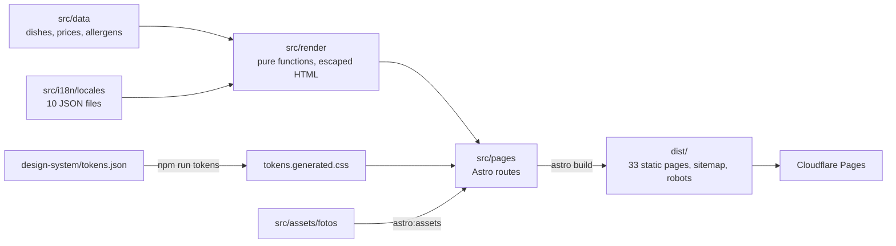

# How it works

The build pipeline, the design decisions behind it and what the audit of the first version fixed.
For deployment and secrets see [deployment.md](deployment.md).

## Project layout

```
design-system/    tokens.json copied from the design system: the only source of colours,
                  spacing, radius, shadows and type scale
src/data/         typed dishes, sections, allergens, prices (in cents) and the list of languages
src/i18n/         one JSON per language; the type is derived from Spanish, so a key
                  missing in any language is a compile error
src/render/       pure functions (context → HTML) with automatic escaping: the content
src/pages/        Astro routes: each page calls its renderer; sitemap.xml and robots.txt
src/layouts/      the shared document: CSS, JS, self-hosted fonts and icons
src/lib/          build helpers: per-language context and the image pipeline
src/assets/fotos/ photo originals (at most 2400 px)
src/client/       progressive enhancement: tabs, language menu, saved preference
scripts/          tokens, favicon, logo, Open Graph image, private data, Instagram posts,
                  gateway check
workers/vigia/    Cloudflare Worker that watches the Netlify gateway and fails back
netlify-puerta/   the Netlify gateway: one rewrite to the origin
tests/            unit (Vitest) and e2e + accessibility (Playwright)
```

## The build, step by step



1. `npm run tokens` turns `design-system/tokens.json` into `src/styles/tokens.generated.css` (not tracked). `dev`, `build` and `typecheck` run it first.
2. `astro build` emits a home, a carta and a menú del día per language, the two legal pages, `404.html`, `sitemap.xml` and `robots.txt`. The `.astro` pages are thin: the HTML comes from the renderers in `src/render`, the same ones the unit tests exercise, with metadata, `hreflang` and JSON-LD (`Restaurant`, plus `Menu` on the carta).
3. Photos go through `astro:assets`: AVIF and WebP at several widths, with hashed names cached for a year (`public/_headers`).
4. Astro's font API self-hosts Montserrat and Lora (Latin and Cyrillic only), generates metric-matched fallbacks so text does not jump when the fonts arrive, and only the Latin Montserrat file is preloaded. Arabic and Chinese use the system fonts.
5. The home page ends with "Novedades", the six latest Instagram posts. `npm run instagram` reads them from the Instagram API with Instagram login (token in the `INSTAGRAM_TOKEN` environment variable, never in a file), keeps six with at most one tagged `#menudeldia`, crops every photo to 4:5 and writes AVIF and WebP copies plus `feed.json` to `public/instagram/` (not tracked). Under each photo go its date and the start of its text, cleaned of emoji and hashtags. On phones the posts are a row to swipe through, like the favourites; on desktop, one row of six. Without that folder (tests, CI, previews) the section shows the six favourite dishes linked to the profile, so it is never empty.

When moving from Vite to Astro the HTML of all 33 pages was compared before and after: same URLs, same text, links, metadata, classes and structured data.

## URL structure

| URL                                    | What it is                                                                     |
| -------------------------------------- | ------------------------------------------------------------------------------ |
| `/carta/`                              | Menu in Spanish (default language). **The URL on the table QR codes.**         |
| `/en/carta/`, `/gl/carta/`…            | Menu in each of the other 9 languages                                          |
| `/`, `/en/`…                           | Home page in each language: dining-room photo and the ways to reach us         |
| `/menu-del-dia/`, `/en/menu-del-dia/`… | Daily set menu: hours, structure and prices; today's dishes are asked on WhatsApp |
| `/aviso-legal/`                        | Legal notice (LSSI). Spanish only                                              |
| `/privacidad/`                         | Privacy policy (GDPR). Spanish only                                            |

The home page lives at `/` and the menu is one button on it; the menu stays at `/carta/` so printed QR codes never change. Old links of the form `/#marino` (the menu used to be the root) are forwarded to the menu by a tiny inline script.

## Design decisions

- **Pre-rendering instead of an SPA.** The original loaded its data with `import()` after mounting, so the first paint was empty and a search engine saw no dishes. The menu is now in the HTML.
- **One URL per language, not a piece of state.** `/en/`, `/gl/`… are real, linkable, indexable pages. The language switcher is a set of links inside a `<details>`, so it works without JavaScript.
- **Language redirect that does not hurt SEO.** Only from the Spanish home and the Spanish menu, using the saved choice or the browser language, and never for crawlers. The function that decides is the same one the tests exercise.
- **Astro as a build tool, not a framework.** Routing, bundling, fonts and images; the HTML still comes from tested pure functions. The migration changed no URL and no page content.
- **No third-party requests at runtime.** Self-hosted fonts split by `unicode-range` (the browser downloads only Latin or Cyrillic, depending on the language; a test checks that all Latin and Russian text fits those two files), inline icons and flags.
- **Prices as integers (cents)**, formatted with `Intl.NumberFormat` per language.
- **Templates escape by default** (`html\`\``); no `innerHTML` with unsanitised data.
- **Real right-to-left Arabic:** `dir` and `lang` on `<html>`, CSS logical properties, no `letter-spacing` (it breaks letter joining) and prices isolated with `unicode-bidi`.
- **The design system rules.** Colours come from `tokens.json` and a test fails if a hand-written colour appears in the CSS. Text is in the brand brown, never grey or on white. The design-system shades for small text (`gold-800`, `terra-700`) already meet AA.

## What the audit of the first version fixed

- A 60 KB proprietary runtime + a 31 KB editor scaffold + an 88 KB design-system bundle, all to render a menu.
- No `<title>`, meta description, `lang` or `main` landmark; insufficient contrast; CLS of 0.73.
- Inline styles everywhere and `!important` hacks that clipped tabs with long names ("Accompagnements").
- Hard-coded Spanish strings (review prompt, "Get directions") that were never translated.
- **Data errors:** in Galician, "peanuts" was translated as "Améndoas" (almonds), a different allergen. Also a typo ("patatas frito") in a dish description.
- `lucide@latest` unpinned and loaded from unpkg.
- A 195 KB logo (2670 px wide) shown at 50 px tall: now 17 KB.

## Tests

- **Unit (Vitest, 657):** every renderer, prices and formats per language, allergens, routes, sitemap, language preference, escaping, the design-system rules, a guard that fails if the real private data ever appears in a tracked file, the Instagram script against a fake API (refused token, Meta down, a tampered published feed) and the gateway and watchman logic.
- **End to end + accessibility (Playwright + axe-core, 161):** every page type in several languages, keyboard use, right-to-left layout, and WCAG checks.
- **Lighthouse CI:** the build fails if the median of 3 mobile runs drops below 90 for performance or 95 for accessibility, best practices or SEO (`lighthouserc.json`).
